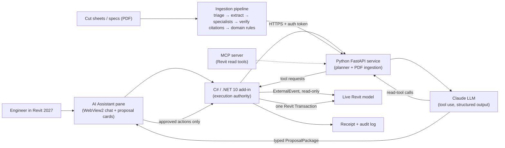

# Bob the Builder: an AI copilot inside Autodesk Revit

**An agentic AI assistant for electrical-prefab engineers. It reads the live Revit model and project documents, proposes cited changes, and writes nothing until an engineer approves it.**

> 🔒 **The source code is private.** This repo is a showcase of the project's purpose, architecture, and my role. **A live demo or walkthrough is available on request.**
>
> Bob the Builder is the engineering codename for the Revit AI agent I'm co-building as **Setuva** with a small team ([@KAUSSHIK](https://github.com/KAUSSHIK), [@rishihk](https://github.com/rishihk), and me).

---

## What it does

VDC engineers in electrical prefab spend hours moving values from cut sheets and specs into Revit, then placing, circuiting, dimensioning, and documenting equipment. Bob the Builder runs in a dockable pane inside Revit 2027. The engineer chats with it in plain language, and it can:

- **Answer questions about the live model.** The agent inspects the model through a fixed set of typed, read-only tools.
- **Read a project document** (for example, a manufacturer cut-sheet PDF) and pull out specs. Every value comes with its source page, the exact source text, and a confidence score.
- **Propose concrete Revit changes** as typed actions. The engineer reviews them one at a time and approves or rejects each.
- **Execute approved changes** in a single Revit transaction, then write a receipt and a local audit log.

It follows three rules: **the AI proposes but never writes on its own, every value cites its source, and the engineer approves every change.**

## Key features

- **Document grounding by design.** Each extracted value carries its provenance (page, span, and confidence), and a verifier checks that every cited span actually appears in the source PDF. Values that fail the check are flagged as anomalies and never proposed.
- **Agent loop over the live model.** The planner calls typed read tools against the open Revit model and keeps going until it can answer or produce a typed proposal.
- **Perception layer.** The agent gets a model overview (levels, views, sheets, schedules, warnings, and element counts), reads schedule and panel-schedule cells, checks sheet and view contents, and captures a view as an image so it can judge visual questions.
- **QA/QC primitives.** These include breadth-first tracing of the MEP connector graph and parameter-filtered queries (for example, finding uncircuited devices in one call).
- **Typed write actions:** set parameters, place elements, create views and sheets, place views on sheets, add detail lines, tags, and dimensions (curve-aware), create power circuits, and generate panel schedules.
- **Review UI.** Each proposed action appears as a card showing confidence, triage tier, citation, and before/after values. Nothing changes until the engineer clicks *Approve & write*.
- **Self-correction.** If an approved action fails in Revit, the failure receipt goes back to the agent, which proposes a fix. The fix also needs approval.
- **Auto-provisioned parameters.** Standard panel parameters are created and bound idempotently when a proposal needs them.
- **MCP integration.** Revit read tools are also exposed through a Model Context Protocol server, so an MCP-capable agent can drive the same tool loop.

## Architecture

**Design principles**
- **Separate read and write paths.** The model gathers evidence freely through read tools. Every change must arrive as a typed `ProposalPackage` and pass the engineer's approval gate, which the add-in enforces, not the model.
- **Structured outputs only.** The planner returns typed JSON, and Python and C# share one contract that is kept in sync.
- **Revit threading is respected.** All model access is marshalled onto the Revit API thread through `ExternalEvent`, and writes happen inside named transactions, so each one can be undone in a single step.
- **No secrets on the customer's machine.** The engineer installs the add-in and signs in, and model credentials stay server-side.

## Tech stack

| Layer | Tech |
|---|---|
| Revit add-in | C#, .NET 10, Revit 2027 API, WPF, WebView2 (embedded HTML/JS chat UI) |
| Backend / planner | Python 3.11+, FastAPI, Pydantic |
| AI | Claude (Anthropic tool use / structured outputs, Amazon Bedrock), Model Context Protocol (MCP) |
| Document ingestion | pdfplumber-based text and table extraction, a multi-agent extraction pipeline, a citation verifier, and an eval harness with a held-out test set |
| Infra | AWS (hosted API), Docker, Inno Setup installer |

## My role

This is a team project. These are the parts I built (about half of all commits across the repo's branches):

- **Document-ingestion pipeline (Python).** I set up the ingestion module, wired the live LLM extraction pipeline, added citation discipline and accuracy fixes based on page-text grounding, and built the later pipeline layers.
- **AI Assistant inside Revit.** I built the WebView2 assistant pane, the *chat → plan → approve → execute* engine, auto-creation of panel parameters, mapping attached spec documents to parameters, and the startup and rendering stability fixes that keep the add-in from destabilizing Revit.
- **Agent and tool layer.** I built the agent loop that inspects the live model through typed read tools, the MCP server and tool broker that let an MCP agent drive the Revit tool loop, and the documentation actions (views, sheets, viewports, detail lines).
- **Electrical and annotation actions.** I built power circuits, panel schedules, tags, curve-aware dimensions, and a bill-of-materials/takeoff tool.
- **Perception and QC.** I built the model overview, schedule/sheet/view reading, view capture so the agent can see the model, connector-graph tracing, parameter-filtered queries, and the self-correction loop for failed writes.
- **Research.** I wrote the Revit add-in and assistant-architecture research briefs that shaped the MCP plus approval-gate design.

## Demo notes

A 5–10 minute walkthrough in Revit 2027 shows:

1. **Live model Q&A.** Ask about the model or the current selection. The agent calls read tools and answers with element-level evidence.
2. **Perception.** The agent gets a model overview, reads a panel schedule, and captures the active view so it can "see" the plan.
3. **Connectivity and QC.** It traces a device's connector graph and finds blank-parameter or uncircuited elements in one query.
4. **Cut sheet to parameters.** Attach a manufacturer PDF and get proposal cards. Each value shows its source page, quoted text, and confidence, and ambiguous values are flagged for clarification.
5. **Approval gate.** Approve some cards and reject others. Accepted changes land in one Revit transaction, followed by a receipt and an audit log.
6. **Write actions.** Create a power circuit, add dimensions and tags, and build a sheet, view, and viewport in one proposal.
7. **Self-correction.** A failed action goes back to the agent, which proposes a corrected plan that needs approval again.
